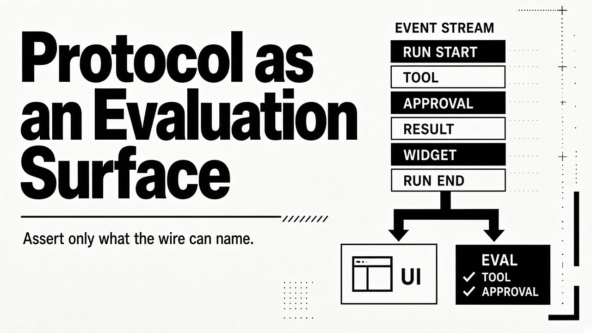
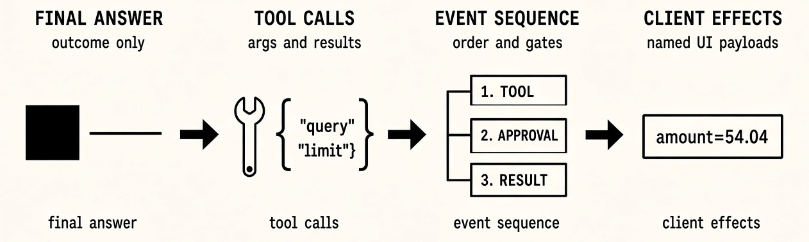
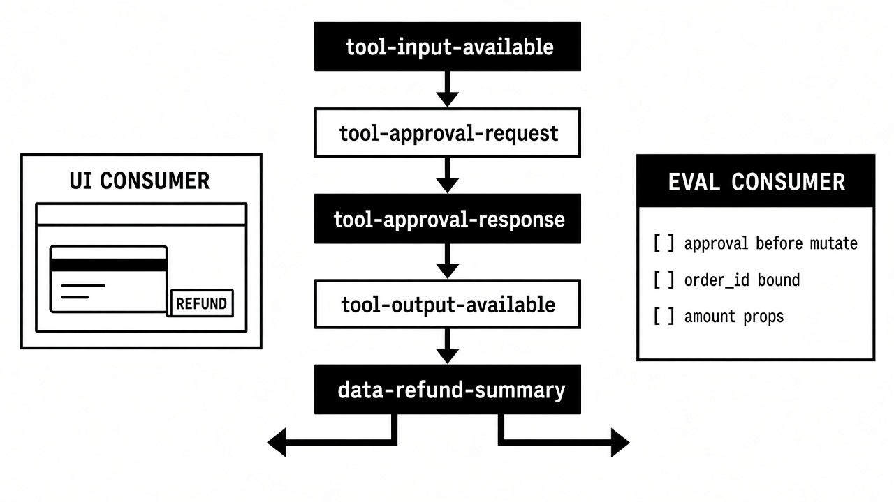

# Protocol as an Evaluation Surface

Even the simplest agents are hard to evaluate well. A structured input–output agent still needs a rubric: what counts as correct, what is an acceptable paraphrase, when refusal is right, how to score messy cases. Some of these checks may be simple deterministic implementations, but much of the work you'll face surrounds what “good” means and keeping that definition honest as the product moves. Nailing that closed in/out pair is already a craft.

Long-horizon agents inherit all of that difficulty and then multiply it. A run that ends with the right refund amount, for example, can still have skipped confirmation, called tools in the wrong order, handed work to the wrong subagent, or pushed a client widget with the wrong props. Outcome-only checks stay green yet the process was wrong. The rubric now has to cover a path—not only a final object.

This piece argues for a simple habit: treat the **agent’s outbound protocol** as the primary evaluation surface. That protocol is the typed event or message stream your consumers already depend on. Often that consumer is a UI, but it can also be another service, a workflow engine, or a partner integration. Regardless, you can only assert what that contract can name. Adopt a dialect that names the hard parts (tools, approvals, delegation, downstream effects), and mid-run checks become ordinary stream consumers rather than browser simulations or transcript archaeology.

## Input–output eval is already a craft

For single-shot systems, structured inputs and outputs at least bound the problem. Every fact you grade lives in the request or the response: fields, enums, scores, free text judged against a rubric. There is no trajectory between them. That does not make evaluation easy. Rubric design, edge cases, and disagreement between human raters will keep you busy. It does mean the surface is finite. A JSON Schema, a typed response, and a written score guide are enough of an evaluation API to start.

Keep that shape for gates, routers, and other single-shot judges—just recognise its ceiling. The moment the system plans, runs tool sequences, pauses for a human, or drives a generative UI, the deliverable is no longer a lone object. Evaluating only the last message is like grading a checkout flow by whether the receipt total looked plausible.

## Agents multiply what you need to check

A production agent run accumulates checks that seldom appear in a single-shot harness:

- **Tool calls:** which tool, with which arguments, with which results.
- **Ordering and policy:** confirmation before mutation; read before write; no forbidden tool after a refuse.
- **Human-in-the-loop:** approval requested, decision recorded, run resumed (or denied) with a clear audit trail.
- **Delegation:** a subagent started and finished; the parent saw a result, not an opaque silence.
- **Downstream effects:** a UI surface or data part with the props the user should see; or a machine-facing payload another system will act on.

Each of those is either **named on the wire** or forced into somewhere worse: log lines, artifact scraping, or an LLM judge reading a novel-length transcript. Naming is what turns “we should probably test that” into a predicate.

τ-bench made the outcome-versus-process gap concrete. Its headline reward compares final database state (and required user-facing strings) against a gold end state, so different tool paths can pass if they land on the same hash ([Yao et al., 2024](https://arxiv.org/abs/2406.12045)). The paper notes the limit: an agent can satisfy the outcome check while violating a documented confirm-before-mutate policy. Follow-on tooling in τ² keeps optional action matching, but the default lesson stands: **green outcomes do not imply a green trajectory.**

## You can only assert what you can name

If your stream is a bag of text tokens, or Server-Sent Events whose `data:` fields are opaque blobs, you can concatenate and judge the ending. But that means you cannot cheaply ask whether an approval event landed before `cancel_order` returned. Without stable event types and identifiers, mid-run evaluation collapses into brittle string search.

A protocol is the vocabulary of those names: discriminators (`type`, `name`), correlation IDs (`toolCallId`, `runId`, `messageId`), lifecycle boundaries, and extension points for domain payloads. The consumer pattern matches that vocabulary. Unnamed facts are untestable facts, or at best expensive ones.

## Transport is not the contract

Teams often reach for “use SSE” as if framing were the design. SSE (or WebSockets, or a broker) moves bytes. It does not decide whether a frame means “tool input ready,” “approval required,” or “here is a weather card.”

[Vercel’s AI SDK](https://ai-sdk.dev/docs/ai-sdk-ui/stream-protocol) draws the distinction clearly. A **text stream** is chunks of plain text. A **UI message stream** is SSE carrying typed JSON parts (`text-delta`, `tool-input-available`, `tool-approval-request`, `data-*`, `finish`, and so on), versioned with a header such as `x-vercel-ai-ui-message-stream: v1`. Same transport family; different evaluation surface.

Custom JSON over SSE is fine when the parts are typed, versioned, and stable. “We stream over SSE” is not, by itself, a protocol. Opaque frames are just a firehose with keep-alives.

## What the protocols already expose

You do not need to invent the vocabulary from scratch. Agent–UI stacks have already converged on typed, ordered event streams. Dialects differ; the shape rhymes.

**Vercel AI SDK UI message streams** name text and reasoning blocks, full tool input/output lifecycles, step boundaries, abort, and (critically) `tool-approval-request` / `tool-approval-response`. Custom `data-*` parts carry structured payloads the client can render or ignore. Transient parts can reach `onData` without landing in message history. For evaluation, that means approvals and widget-shaped data are first-class frames, not afterthoughts stuffed into prose.

**AG-UI 1.0** standardises one request in and an ordered stream of typed events out: thirty-one event types across lifecycle, text, tools, reasoning, state, activity, subagents, and passthrough `CUSTOM` / `RAW` ([spec](https://docs.ag-ui.com/spec/1.0)). Arrival order is the protocol’s order; timestamps are informational. Human-in-the-loop is modelled as a terminal interrupt (`RUN_FINISHED` with an interrupt outcome) and a following run that carries `resume` entries ([interrupts](https://docs.ag-ui.com/concepts/interrupts)). Subagent start/finish events make delegation visible. The roles in the spec matter for testing: a producer emits; a consumer may be a UI, a recorder, or another proxy. Nothing in the protocol requires a browser.

**A2UI** pushes the client surface further: agents stream declarative UI messages (`createSurface`, `updateComponents`, `updateDataModel`, and kin) rather than hoping the chat transcript implies a layout ([A2UI protocol](https://a2ui.org/specification/v1.0-a2ui/)). Asserting that a confirmation card carried `amount: 54.04` becomes a payload check, not a Playwright selector hunt.

**LangGraph** exposes stream modes and, in newer event streaming, typed projections (tools, lifecycle, human-in-the-loop `input`, custom payloads) with multiple consumers reading concurrently ([event streaming](https://docs.langchain.com/oss/python/langgraph/event-streaming)). **OpenAI’s Agents SDK** separates raw model events from semantic `run_item_stream_event` names (`tool_called`, `tool_output`, handoffs, MCP approval, and so on) and treats interruptions as an explicit pause/resume path ([streaming](https://openai.github.io/openai-agents-python/streaming/)). **Mastra** lands in the same family of start/text/tool/step/finish chunks, with extra events when work fans out across a network of agents.

The point is not to crown a winner. Production stacks already treat **named mid-run facts** as a consumer contract. Evaluation should subscribe to the same contract.

That lesson is not limited to chat UIs. Agent–UI protocols had to name tools, approvals, and progressive updates in public; that makes them useful witnesses. Machine-to-machine products need the same discipline under a different label: an event schema, a streaming API contract, a webhook body, a queue message type. If another system will parse your agent’s progress or results, you already have a data contract, so use it as the eval surface. An opaque blob between services is the same naming problem as a text stream, just without the spinner.

## Protocols name the tests you’d otherwise forget

Adopting a known dialect does more than save schema design time. It hands you a checklist of concerns the authors already had to confront.

Human-in-the-loop is the clearest example. Once a protocol has approval requests, interrupt outcomes, or an `input` projection, “did we stop for confirmation?” and “did we disambiguate before acting?” stop being soft product hopes. They become evaluation items with stable shapes: an approval part before a tool output; a resume payload before mutation; a clarification tool before a write. Teams that only assert the final answer often discover too late that those gates never fired.

The same holds for delegation and downstream effects. Subagent lifecycle events ask whether fan-out is real or cosmetic. `data-*` parts and A2UI updates ask whether the user-visible summary matches the tool result; a typed webhook or queue event asks the same of a receiving service. If the protocol can say it, your suite should decide whether to require it. Gaps in the dialect are product decisions; silence in the suite is an accident.

## The headless consumer

Because the protocol is a stream of typed events, no single consumer is privileged: not the UI, not the downstream service. A test harness can drain the same frames: record them, filter by type, assert order and payloads, and finish without mounting React, driving a browser, or standing up the real integrator.

That is the practical dividend. End-to-end product tests still earn their keep for layout, accessibility, and true device behaviour. They are the wrong default for “did the agent request approval before `cancel_order`?” Headless protocol consumers give you trajectory checks that run like integration tests: fast, deterministic, and close to the contract you ship.

Mocking follows for free. A producer test double emits a golden sequence; a consumer test double asserts it. You are not simulating a frontend or a partner stack so much as speaking the dialect those consumers already speak.

## A trajectory you can grade

Take a refund-and-cancel path. Policy: confirm before mutate. Dialect-agnostic skeleton:

1. Run (or message) starts.
2. Tool call proposed: e.g. `cancel_order` with a bound order id.
3. Approval or interrupt requested.
4. Resume with an explicit approve (or deny).
5. Tool result for that same `toolCallId`.
6. Downstream effect: a `data-refund-summary` part, or an A2UI `updateDataModel`, carrying the amount.
7. Assistant text wrap-up; run finishes successfully.

Cheap asserts on that stream: (3) precedes (5); arguments carry the expected order id; denial produces no successful mutate; (6) matches the tool result; no silent tool output without a decision. Map the steps onto Vercel approval parts, AG-UI interrupt/resume, or your own typed frames. The predicates stay the same.

Now the failure twin: the tool result arrives, the database ends correct, and only afterward does the stream mention confirmation (or never does). An outcome harness can still pass. A protocol harness fails at the missing gate. That is the whole argument in one trajectory.

## Trajectory is lineage

Getting into the weeds on mid-run structure does not trap you in pedantic checks. It is what makes broader evaluation possible, especially online, where you often lack a labelled ground truth.

You cannot score “correctness” in production the way a golden-answer suite does: there is no oracle answer waiting in the dataset. You *can* design evaluators that use the trajectory as lineage. A faithfulness check over a RAG turn is the plain example: take the observation events (chunks, citations, tool payloads), then ask whether the final synthesis invents claims those observations do not support. The judge is not scoring the answer in isolation; it is comparing the answer to the evidence the run actually saw. Without named retrieval and answer events on the wire, or in a durable trace of the same shape, that evaluator has nothing solid to bind to.

The same pattern generalises. Did the summary match the tool result? Did the handoff brief reflect the delegate's output? Did the customer-facing email stay inside the policy documents that entered context? Holistic quality questions become tractable when you can point at predecessors in the stream. Trajectory evaluation, in that sense, is a testing philosophy about **lineage**: assert relationships along the path, not only a grade on the last token.

## Shrink the surface you have to grade

Protocol asserts also pressure architecture. If grading a single run means tracking a dozen tools, three nested handoffs, and a cloud of UI events, the test is telling you the workflow is too wide, not only that the harness is weak.

Treat that pain like classical testing already does. Broad end-to-end paths are expensive and brittle; teams push behaviour down into smaller integration seams. For agents, the seam is often a delegated sub-trajectory, a deterministic step pulled out of the model loop, or a sharper tool that collapses five calls into one. The smaller the remaining event surface, the easier the trajectory is to name and to grade.

Use evaluation as feedback: hard-to-assert paths are candidates for simplification. Do not grow the protocol to describe chaos you should have decomposed.

## What the protocol will not save you from

A typed stream is not a substitute for judgment.

Not every internal thought belongs on the wire. Over-protocolizing creates noise events nobody should assert. Prefer causal order (“approval before tool result”) over wall-clock timing. Version the dialect the way Vercel versions stream headers; silent renames break suites and clients together.

Some properties stay outside any wire protocol: open-ended preference, user satisfaction, environment oracles that only a real database can answer. Keep human review and env checks for those. Where you do use model judges (faithfulness, policy adherence, summary fidelity), feed them the lineage the protocol (or an equivalent trace) already named. A judge without predecessors is just another outcome guess.

## The takeaway

Input–output systems taught us that structured contracts and clear rubrics make evaluation *tractable*, not automatic. Agents moved more of the interesting facts into the middle of the run: tools, approvals, delegation, downstream effects. Those facts are only cheap to test when they have names. Named mid-run structure is also how you evaluate more holistically when gold labels are missing. Faithfulness and similar checks are lineage questions dressed as quality scores.

Adopt (or design) a protocol that names them. Let that vocabulary tell you what to test. Consume it headlessly for trajectory checks. When the surface is too large to grade, simplify the workflow until it isn’t. Evaluation follows the wire contract. Chosen well, that contract follows the product risks you actually care about.

### Further reading

- [Vercel AI SDK — Stream Protocols](https://ai-sdk.dev/docs/ai-sdk-ui/stream-protocol)
- [AG-UI Specification 1.0](https://docs.ag-ui.com/spec/1.0); [Interrupts](https://docs.ag-ui.com/concepts/interrupts)
- [A2UI Protocol](https://a2ui.org/specification/v1.0-a2ui/)
- [LangGraph — Event streaming](https://docs.langchain.com/oss/python/langgraph/event-streaming)
- [OpenAI Agents SDK — Streaming](https://openai.github.io/openai-agents-python/streaming/)
- [Mastra — Streaming overview](https://mastra.ai/docs/streaming/overview)
- Yao et al., τ-bench, [arXiv:2406.12045](https://arxiv.org/abs/2406.12045)

