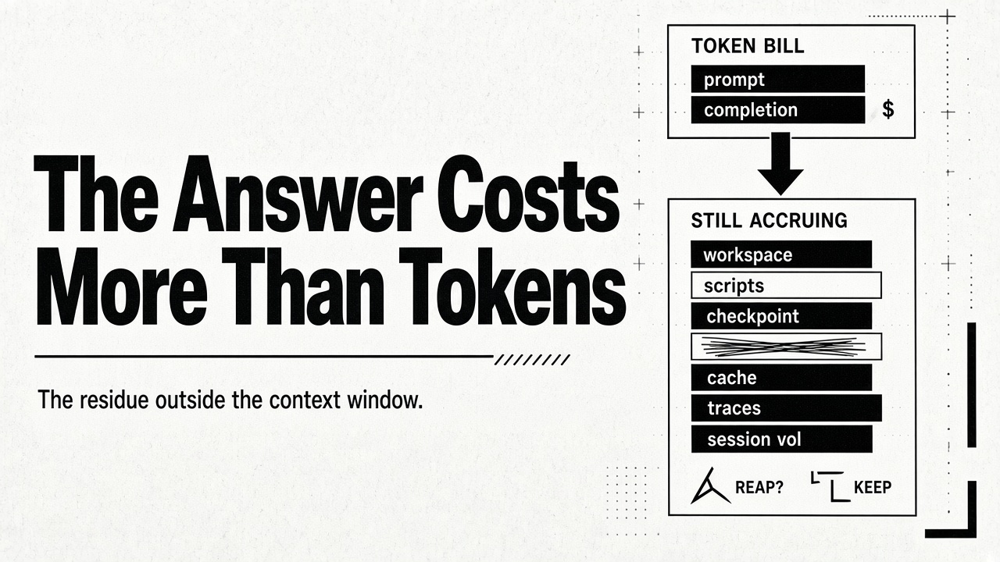
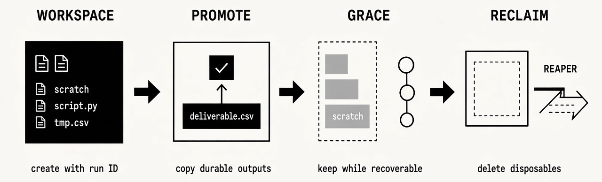
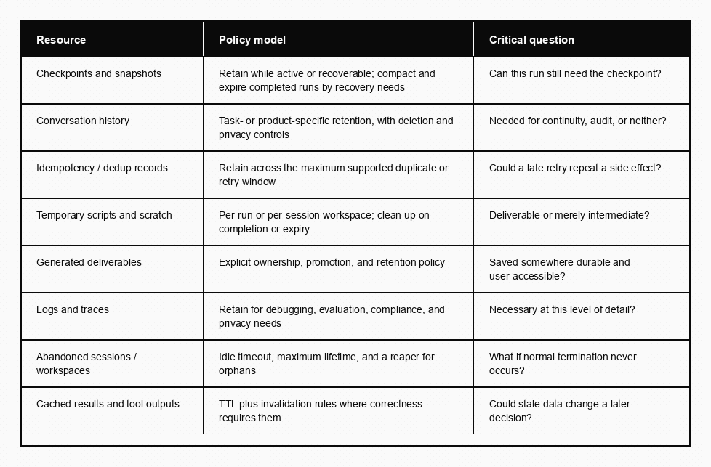

# The Answer Costs More Than Tokens

Token spend is the cost most teams can already see and focus on. Prompt and completion show up on the invoice, the dashboard, and the postmortem when a loop runs hot. But production agents also write outside the context window—workspaces, checkpoints, caches, traces, and deliverables among them. That residue is part of what the answer cost, whether your metering treats it that way or not.

The usual emphasis on context optimisation is not wrong: it's incomplete. Context is only one retention surface. An agent with a computer accumulates more like a batch job than a chat turn, and the operational question is what happens to those artefacts when the process ends, when a session idles out, or when a user asks you to delete a conversation. Keep everything and you pay in storage, risk, and privacy; delete without a policy and you lose a deliverable. So treat the footprint as a designed surface: owned resources, retention contracts, promotion paths, and reclaim triggers.

## Beyond the window

Google’s guidance on [production-ready agents](https://cloud.google.com/blog/products/ai-machine-learning/a-devs-guide-to-production-ready-ai-agents) describes the jump from prototype to production in terms of memory, orchestration, testing, and security. Lifecycle cleanup sits in the same gap. It tends to arrive after the demo already worked, once someone notices that session volumes, scratch files, and full-fidelity traces have been accruing quietly beside the token bill.

What the run leaves behind looks less like a conversation log and more like a job’s working set. Some of it is there so you can resume after interruption. Some of it is scratch the agent needed along the way. Some of it is what the product is supposed to expose. You do not need a taxonomy on day one, but you do need to stop treating “the conversation” as the only thing that remains.

Durability makes that footprint larger on purpose. A durable agent is designed to outlive a single process, so event histories, checkpoints, and snapshots exist to pause, fail over, and resume without starting from zero. That is the point of runtimes such as Google’s [Agent Executor](https://cloud.google.com/blog/products/ai-machine-learning/agent-executor-googles-distributed-agent-runtime/), and it is a tax you pay for recoverability. The longer and more interruptible the work, the more history you retain unless you compact and expire it. An orphaned workspace burns money and privacy surface; a missing checkpoint burns recoverability; a missing deliverable burns trust; a retained trace burns compliance budget when it still holds payloads you no longer need at full fidelity. One retention rule for all of them invents the wrong trade-off on purpose.

## Compute dies; storage often does not

The easy mistake is to equate process lifetime with data lifetime—to assume that evicting the runtime, killing the container, or stopping the session also cleared the files. It often does not. For example, [Cloudflare’s Agents filesystem](https://developers.cloudflare.com/agents/tools/filesystem/) keeps a persistent workspace backed by SQLite in a Durable Object, so files survive eviction and restart. Google’s [Agent Compute Engine](https://cloud.google.com/blog/topics/ai-infrastructure/agent-compute-engine-deep-dive) framing is blunt about the other half of the stack: serious agents need machines and filesystems, not only model endpoints. When the plan executes on a machine, that machine’s disk becomes part of the product’s operational surface.

Managed platforms already encode different deletion contracts for different stores. [Amazon Bedrock AgentCore filesystem configurations](https://docs.aws.amazon.com/bedrock-agentcore/latest/devguide/runtime-filesystem-configurations.html) document per-session storage that survives stop/resume and expires after inactivity, alongside persistent volumes and customer-managed object or shared filesystems with their own semantics. [Code Interpreter sessions](https://docs.aws.amazon.com/bedrock-agentcore/latest/devguide/code-interpreter-session-characteristics.html) add another clock again—timeouts, session-data TTL, cleanup on terminate. Scratch space, a resumable workspace, and a shared dataset are not one TTL wearing three labels.

That split is the lesson whether or not you buy a managed runtime. Ephemeral compute with sticky files is a common pattern—not a bug. Reclaim logic has to know which store it is talking to, which run owns the bytes, and whether those bytes are still referenced by something that outlived the process. A single global “delete after N days” does not resolve those questions. It postpones the fight between recoverability and cost.

## Persistence is not a lifecycle policy

Storing state durably answers whether you can resume, audit, or debug. It does not answer when that state is obsolete. Scratch, checkpoints, conversation history, traces, and deliverables want different clocks—even when they began in the same workspace. Active scratch should die with the run, or shortly after you know nothing will resume. Checkpoints should live for the recovery window you actually support, then compact or expire. History and traces follow product, privacy, and compliance rules that rarely match that window. Long-lived deliverables should not share a fate with temporary scripts.

Product behaviour already hints at multiple clocks. OpenAI’s help material for [ChatGPT agent](https://help.openai.com/en/articles/11752874-chatgpt-agent) separates conversation history from browsing artefacts and screenshots, with deletion-related retention that is not identical to “the chat is gone, therefore everything is gone.” You do not have to copy those numbers, but you do have to notice that session state, user-visible history, and backend deletion are not one dial.

## Own it, classify it, reclaim it

Lifecycle policy is three fields on every resource class: who owns it, which retention class it belongs to, and what triggers cleanup. Ownership can be a run ID, a user, a tenant, or a workflow. Without an owner, reclaim becomes guesswork—and guesswork is how you delete the wrong file or keep the expensive one forever.

The useful distinction inside a workspace is between disposable intermediates and durable deliverables. An agent may generate twenty files to produce one spreadsheet the user asked for. Only that spreadsheet should be promoted—copied into durable, user-accessible storage with an explicit owner—before you reap the rest. Promotion is a deliberate copy or move with a new retention contract, not leaving a path in scratch and hoping someone finds it later. If nothing was promoted, either the run produced nothing worth keeping or your cleanup path is about to erase the only copy.

Logical completion is not the same as physical reclamation. Mark the run complete when the work is done, keep scratch for a grace period if you still support resume or late debugging, and delete afterward. Grace is how cleanup stops racing a still-legal recovery window, and how you avoid pretending every byte must be immortal because someone might ask tomorrow.

Abandoned work needs its own path. Idle timeout, maximum lifetime, and a periodic reconciler cover the cases normal termination never reaches. Budgets and deadlines matter here mainly as termination events—the moment reclaim is allowed to run. Without a reaper, temporary becomes permanent by accident. Count orphaned workspaces the way you would count leaked connections; the failure mode is the same shape.

Some residue exists so a later call stays correct: idempotency records, cached tool responses, recovery handles. These are not the agent’s memory in the product sense. They are trails left so a retry or a cache hit does not invent a second side effect. They still need a TTL compatible with the window during which a duplicate or a stale hit is possible, and then they need to be pruned. Stripe’s [idempotent requests](https://docs.stripe.com/api/idempotent_requests) documentation is a useful reminder that even correctness machinery is retained state with an eventual reclaim story. Delete the trail too early and you reintroduce the duplicate; keep it forever and you have invented a second database nobody owns.

Traces are another persistence layer people forget to budget. [OpenAI’s agent tracing](https://developers.openai.com/api/docs/guides/agents-api/tracing) covers turns, tool calls, delegated work, and payloads in enough detail that full fidelity forever is a privacy and cost decision disguised as caution. Keep what you need for debugging, evaluation, and audit; sample, redact, or expire the rest.

## A lifecycle matrix you can apply

You do not need universal TTLs. You need a policy model per resource class and a question that forces an honest answer before you delete—or before you keep forever. The matrix below is that checklist; the prose does not need to restate every row.

Apply it with the two clocks already named: logical completion and physical reclamation. A run can be marked complete while its artefacts remain available for a grace period. A workspace can expire while a promoted deliverable remains permanent. Design those separately, or one will silently own the other.

## Walkthrough: a code-interpreter agent

For an agent that writes and runs code in an isolated session, the habit is concrete. Key the workspace to a run ID with ownership and expiry. Keep intermediates there, promote only what the product should expose, and retain only as much recovery state as you still support. After a grace period, delete the disposables; reconcile periodically for orphans whose normal cleanup path failed.

The failures worth rehearsing stay on this surface. Cleanup races a still-legal resume. A deliverable never gets promoted, the run reports success, and the session TTL erases the only copy. Quieter still: the happy path cleans up, but crashed workers leave sessions the reconciler never learns about because nobody indexed them by owner and expiry. Those are lifecycle bugs, not model bugs.

If you want a metric that keeps the architecture honest, start with retained bytes per completed run, orphaned workspace count, and cost per successful task—including storage and session time, not only model spend. The token meter can look fine while those climb.

## Takeaways

1. **Inventory the residue** outside the context window before you debate TTLs.
2. **Classify before you delete.** Different resource classes want different retention contracts.
3. **Promote, then reap.** Copy durable outputs out with an owner; treat the rest as disposable after a grace period.
4. **Reap what termination never reaches**—idle timeouts, max lifetime, and a reconciler for orphans.
5. **Measure more than $/1K tokens.** Retained bytes and orphaned workspaces catch the bill the meter hides.

The answer was never only the completion tokens. Design for the rest of the bill, or the residue will design it for you.

### Further reading

- Google Cloud, [Agent Compute Engine deep dive](https://cloud.google.com/blog/topics/ai-infrastructure/agent-compute-engine-deep-dive)
- Google Cloud, [Introducing Agent Executor](https://cloud.google.com/blog/products/ai-machine-learning/agent-executor-googles-distributed-agent-runtime/)
- Google Cloud, [A developer’s guide to production-ready AI agents](https://cloud.google.com/blog/products/ai-machine-learning/a-devs-guide-to-production-ready-ai-agents)
- Cloudflare Agents, [Filesystem](https://developers.cloudflare.com/agents/tools/filesystem/)
- Amazon Bedrock AgentCore, [File system configurations](https://docs.aws.amazon.com/bedrock-agentcore/latest/devguide/runtime-filesystem-configurations.html); [Code Interpreter session characteristics](https://docs.aws.amazon.com/bedrock-agentcore/latest/devguide/code-interpreter-session-characteristics.html)
- OpenAI, [Tracing](https://developers.openai.com/api/docs/guides/agents-api/tracing); [ChatGPT agent](https://help.openai.com/en/articles/11752874-chatgpt-agent)
- Stripe, [Idempotent requests](https://docs.stripe.com/api/idempotent_requests)
